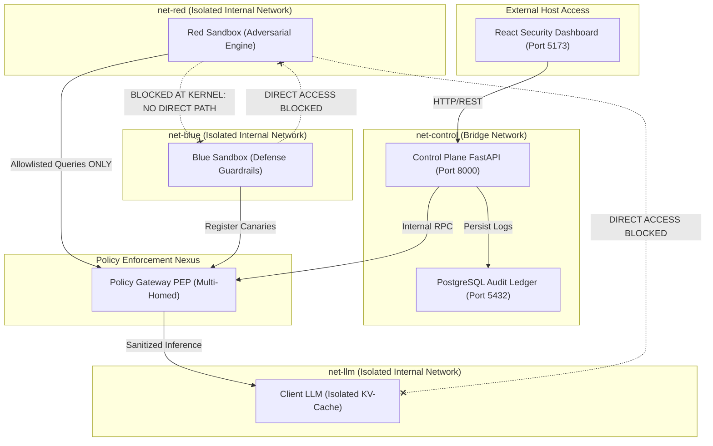

# Bayora — Secure Adversarial AI Safety Testing Sandbox

[](https://github.com)
[](https://github.com)
[](https://github.com)
[](./LICENSE)

---

## 🎯 Executive Summary & Problem Statement

In adversarial AI safety testing, **Red Teams** (adversarial jailbreaks, prompt injection), **Blue Teams** (defense classifiers, canaries), and the **Client LLM** (model under evaluation) typically share a single Docker container or flat network bridge in cloud sandboxes. 

This creates severe vulnerabilities:
1. **Cross-Talk & State Contamination:** Red and Blue teams can sniff each other's processes, socket connections, and secrets.
2. **KV-Cache Attention Leakage:** Shared LLM instances retain prompt tokens across evaluation turns, allowing Red teams to steal defense canaries from unpurged attention caches.
3. **Side-Channel Timing Exploits:** Red teams measure LLM token generation latency jitter to deduce when defensive guardrails trigger.
4. **Audit Log Tampering:** Without cryptographic chaining, compromised sandboxes can rewrite evaluation records to conceal safety failures.

### The Bayora Solution
**Bayora** enforces a **Zero-Trust Micro-Segmented Architecture**:
- **Zero Direct Path:** Red and Blue sandboxes operate in isolated Docker bridge networks (`net-red` vs `net-blue`) with zero shared network interfaces.
- **Policy Gateway (PEP):** The sole mediation nexus. Enforces strict allowlists, canary string tripwires (`BLUE-SECRET-*`), 100ms response timing padding, and rate limits.
- **Append-Only Cryptographic Hash Chain:** All evaluation events are bound with SHA-256 hash chains sealed with HMAC-SHA256 signatures, providing instantaneous tamper detection.
- **Kernel-Level Hardening:** Containers run with `read_only` root filesystems, `CAP_DROP ALL`, seccomp filters (`SCMP_ACT_ERRNO`), and cgroup memory/PID constraints.

---

## 🏗️ Architecture



---

## ⚡ Quick Start

### 1. Prerequisites
- [Docker Desktop](https://www.docker.com/products/docker-desktop/) installed & running
- [Node.js](https://nodejs.org/) v18+ (for local dashboard dev)
- [Python](https://python.org/) 3.11+ (optional, for standalone host tests)

### 2. Launch the Microservices Stack
```bash
# Build and run all 6 hardened containers
docker compose up --build -d

# Verify all containers are healthy
docker compose ps
```

### 3. Launch the React Cyber Dashboard
```bash
cd dashboard
npm install
npm run dev
```
Open **[http://localhost:5173](http://localhost:5173)** in your browser.

---

## 🧪 Interactive Prototype Capabilities

### 1. SecOps / Admin View
- **Interactive Network Topology Map:** Visual inspection of all 6 nodes, network boundaries, and the active `NO DIRECT PATH: RED <x> BLUE` kernel isolation barrier.
- **Cryptographic Hash Chain Audit Ledger:** Live view of sequential events linked by SHA-256 hashes and HMAC signatures.
- **Live Chain Verification:** Click **"Verify Chain Integrity"** to compute real browser Web Crypto SHA-256 + HMAC proofs across all records.
- **Tamper Simulation:** Click **"Simulate Tamper (Block #2)"** to simulate an attacker altering an event payload. The audit engine immediately alerts `TAMPER DETECTED: CRYPTOGRAPHIC HASH CHAIN COMPROMISED!` and highlights the broken block in red.
- **Container Hardening Posture Matrix:** Runtime verification of read-only rootfs, dropped Linux capabilities, seccomp filters, and cgroup limits.

### 2. Red Team (Adversarial) View
- **Adversarial Attack Studio:** Select presets including *DAN Jailbreak*, *Canary Exfiltration*, *KV-Cache Memory Bleed*, and *Direct Container Probe*.
- **Gateway Dispatch:** Sends payloads through the Policy Gateway to the Client LLM. Observe canary interception (`HTTP 403`) and 100ms timing normalization padding.
- **Direct Cross-Talk Test:** Click **"Direct Blue Probe"** to launch an ARP / TCP connect to Blue sandbox (`172.28.2.10:8000`). In Bayora's isolated mode, the Linux kernel immediately refuses the connection (`ECONNREFUSED` / No route to host).

### 3. Blue Team (Defensive) View
- **Tripwire Canary Vault:** Deploy tripwire canaries (e.g. `BLUE-SECRET-9481-ALPHA`). If a prompt or LLM completion contains this string, the Policy Gateway blocks transmission.
- **Policy Filter Toggles:** Toggle Canary Interception, 100ms Timing Normalization, Session KV-Cache Isolation, and Rate Limiting.
- **Defense Guardrail Test Suite:** Execute automated validation across 5 adversarial attack archetypes with latency metrics.

---

## 📂 Repository Structure

```
├── control-plane/          # FastAPI Central Orchestrator & Audit Service
│   ├── app/main.py         # Auth, evaluation lifecycle, hash chain logic
│   └── Dockerfile          # Hardened non-root Dockerfile
├── gateway/                # Policy Gateway (PEP)
│   ├── app/main.py         # Allowlists, canary detection, timing normalization
│   └── Dockerfile
├── sandboxes/
│   ├── red/                # Red team adversarial generator container
│   ├── blue/               # Blue team defense & canary container
│   ├── client-llm/         # Mock LLM with per-session KV-cache isolation
│   └── seccomp-profile.json# Restrictive Linux syscall whitelist
├── dashboard/              # React 19 + Vite Dark-Theme Cyber Dashboard
│   ├── src/                # Admin, Red, Blue views & Crypto engine
│   └── package.json
├── docs/
│   ├── THREAT_MODEL.md     # Assets, trust boundaries, 13 STRIDE threats
│   └── DEMO.md             # 3-4 minute presentation walkthrough script
├── tests/
│   └── test_integration.py # 7 automated test suites for live stack
├── docker-compose.yml      # Multi-network micro-segmentation definition
└── LICENSE                 # MIT License
```

---

## 🛡️ Threat Model & Defense Invariants

| Threat Vector | Naive Shared Sandbox | Bayora Countermeasure |
|---|---|---|
| **Red ↔ Blue Cross-Talk** | Shared bridge; Red scans Blue ports | Separate Docker networks (`net-red`, `net-blue`); kernel drops SYN packets |
| **KV-Cache Attention Bleed** | LLM retains context across turns | Strict session context purge; separate memory namespaces |
| **Canary Exfiltration** | Secrets read from filesystem/memory | `read_only` rootfs + Gateway canary string interceptor |
| **Timing Side-Channels** | Token jitter reveals defense triggers | Synthetic 100ms timing pad normalizes response curves |
| **Audit Log Mutation** | Flat database rows can be edited | Cryptographic SHA-256 hash chain with HMAC signatures |
| **Container Breakout** | Full Linux root capabilities | `CAP_DROP ALL`, `SCMP_ACT_ERRNO` seccomp filter, non-root user (1000:1000) |

---

## 👥 Team Dark Panthers
- **Priyanshu** — Full Stack & Cloud Infrastructure / Architecture
- **Anagh** — Cyber Security & AI Safety

- **Hack in Hills '26** — Problem Statement 04: Securing Adversarial AI Safety Testing Infrastructure

## 🛠️ Tech Stack
### Backend (Control Plane & Gateway)
- **Language**: Python 3.11+
- **Framework**: FastAPI
- **Database**: PostgreSQL 14+
- **Networking**: Linux Bridge (`net-control`, `net-red`, `net-blue`)

### Frontend (React Dashboard)
- **Framework**: React 19 + Vite
- **UI Library**: Tailwind CSS 4
- **State Management**: Zustand

### Infrastructure
- **Containerization**: Docker Compose
- **Security**: Seccomp (SCMP_ACT_ERRNO), Linux capabilities drop, Read-only rootfs